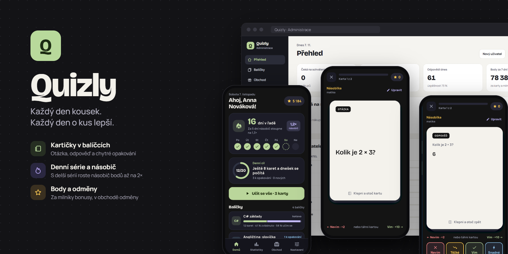
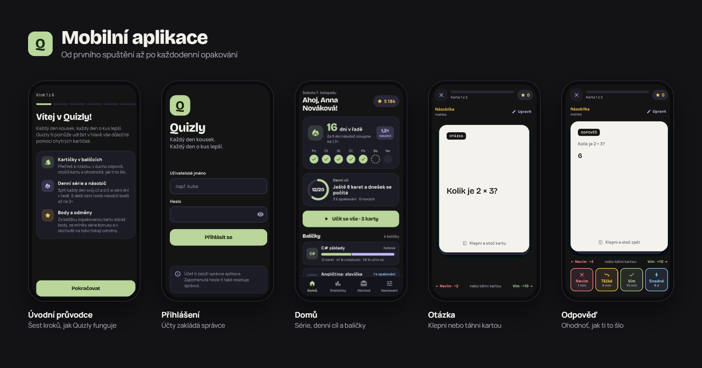
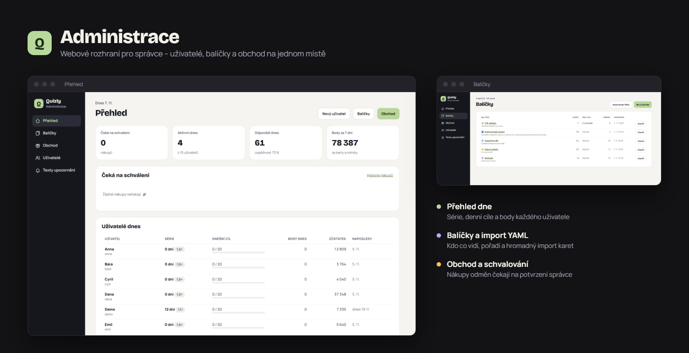
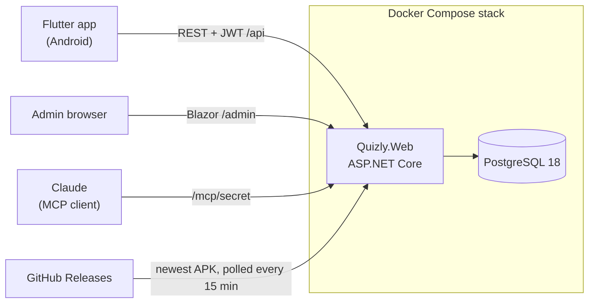

<p align="center">
  
</p>

# Quizly

A private Android flashcard app in Czech that keeps you studying with spaced repetition, a daily streak, points and real-life rewards you buy in a shop.

I built it for myself and a few friends. One admin manages everything in a web dashboard, and the app users only use the phone. The UI is Czech only; code, docs and commits are in English.

## Screenshots



### Mobile app

From the first launch to the daily review: the intro, login, home with the streak and daily goal, and the question and answer sides of a card.



### Admin dashboard

A web dashboard for the admin: overview, users, decks with YAML import, the shop and claim approval.



The original design proposal (10 phone screens and the admin pages) is in [`docs/design/`](./docs/design/); open the HTML file in a browser.

## What it does

- The server schedules every card with FSRS-6 (a port of py-fsrs 6.3.2). Tap a card to flip it, then swipe or press *Vím* / *Nevím*. An optional mode adds *Těžké* and *Snadné*.
- Correct answers earn points. A longer streak raises the multiplier up to 2×, and streak milestones pay bonuses. A day counts once you reach your daily goal.
- Points buy real-life rewards in a shop ("go for pizza"). The admin approves or rejects each purchase, and a rejection refunds the points.
- Notifications are scheduled on the phone. The Czech texts are gender-neutral and the admin can edit them. The evening reminder moves toward your usual study time, and nothing shows during quiet hours.
- Statistics cover a heatmap, daily bars, success by weekday, deck progress and a leaderboard.
- The admin edits a whole deck as YAML and sees a preview of the changes before saving, and users keep their progress. App users can add and edit cards too, and cards can have tags.
- Claude can list, read and update decks through a remote MCP server. It never deletes anything. See [`docs/mcp.md`](./docs/mcp.md).
- The app offers new releases and installs the APK itself, even though the repository is private and the app is sideloaded.

## Tech stack

| Part | Technology |
| --- | --- |
| Android app | Flutter (Dart), Android 8.0+, Riverpod, go_router, Dio |
| API | ASP.NET Core on .NET 10, REST, JWT with rotating refresh tokens |
| Admin dashboard | Blazor Server in the same app, at `/admin` |
| Database | PostgreSQL 18 through EF Core 10, migrations applied on startup |
| MCP | ModelContextProtocol.AspNetCore (Streamable HTTP) |
| Hosting | Docker Compose in Portainer, behind Nginx Proxy Manager |
| CI/CD | GitHub Actions: tests, Docker image to GHCR, signed release APK |

## How it fits together



Everything that counts (FSRS, points, streaks, claims) is calculated on the server. The app only displays what the server returns, so an internet connection is required. Each review carries a client-generated UUID, so a retried request never awards points twice.

The solution is split into `Domain` (entities and pure logic), `Application` (use cases shared by REST, Blazor and MCP), `Infrastructure` (EF Core) and `Web` (the host). Details are in [`docs/architecture.md`](./docs/architecture.md).

## Repository layout

```
src/           ASP.NET Core solution (Domain, Application, Infrastructure, Web)
tests/         xUnit tests, with PostgreSQL 18 through Testcontainers
app/           Flutter app
deploy/        docker-compose files, .env.example, backup and restore scripts, runbook
docs/          spec, API, YAML format, notifications, MCP, app updates, design, FSRS vectors
presentation/  logo, hero banner and screenshots used in this README
.github/       CI workflows
```

## Getting started

### API and dashboard

You need the .NET 10 SDK and Docker.

```bash
docker compose -f deploy/docker-compose.dev.yml up -d
```

```bash
dotnet run --project src/Quizly.Web
```

- Admin dashboard: http://localhost:5278/admin (dev credentials are in `src/Quizly.Web/appsettings.Development.json`).
- Swagger UI: http://localhost:5278/api/docs (sign in with `POST /api/admin/auth/login`).
- Example requests for every endpoint: `src/Quizly.Web/Quizly.Web.http`.

On the first Development start with an empty database, the app creates sample users, decks, a shop and about six weeks of study history. The history is replayed through the real FSRS, points and streak rules, so balances, streaks and charts add up. Every sample user has the password `123`.

| User | Story |
| --- | --- |
| `anna` | 16-day streak (1,2×), today 12 of 20, a confirmed, a pending and a sold-out purchase, hearted rewards, sees the restricted deck "Anatomie" |
| `petr` | Streak of 10 that broke 4 days ago, "Těžké a Snadné" on, a rejected purchase |
| `eva` | 3-day streak with today's goal met, shop off, hidden from the leaderboard |
| `novacek` | Brand new, nothing studied, for the first-run screens |
| `stary` | Deactivated, cannot log in |

Set `Seed__DevelopmentData=false` to skip the sample data. To start over, run `pwsh deploy/dev-reset.ps1` (it deletes the dev database volume) and start the API again.

### Android app

You need Flutter (stable) and the Android SDK. See [`app/README.md`](./app/README.md) for the signing key and installing the APK.

```bash
cd app
flutter run --dart-define=API_BASE_URL=http://10.0.2.2:5278
```

`10.0.2.2` is the PC as seen from the Android emulator. Without `--dart-define` the app talks to `https://quizly.jbohacek.cz`.

### Tests

Docker must be running, because the integration tests start PostgreSQL 18.

```bash
dotnet test --solution Quizly.slnx
```

```bash
cd app
flutter test
```

### Whole stack in containers

Copy `deploy/.env.example` to `deploy/.env`, fill it in, then build from this checkout:

```bash
docker compose -f deploy/docker-compose.yml -f deploy/docker-compose.build.yml up --build
```

### Adding a migration

```bash
dotnet tool restore
dotnet ef migrations add <Name> --project src/Quizly.Infrastructure --output-dir Persistence/Migrations
```

## Deployment and releases

- Every push to `main` builds a Docker image and pushes it to a private GitHub Container Registry. I pull the new tag and redeploy the stack in Portainer. Nginx Proxy Manager handles HTTPS and forwards to the container, with websockets on because Blazor Server needs them.
- A nightly `pg_dump` from the server's cron keeps the newest 14 dumps, and `deploy/restore.sh` brings one back.
- A `v*` tag builds a release APK signed with a fixed keystore, so a new APK installs over the old one without losing the login. Tags with a `-` (such as `v1.0.1-beta.1`) are pre-releases that phones are never offered.
- For updates on the phone, the server asks GitHub for the latest full release, downloads and verifies the APK, and serves it to logged-in users. The read-only GitHub token stays on the server and is never in the APK.

The step-by-step guide, update and rollback, restore, and secret rotation are in [`deploy/README-deploy.md`](./deploy/README-deploy.md). The update flow is described in [`docs/app-updates.md`](./docs/app-updates.md).

## What I learned

- How to work with AI coding tools: Claude Code and Antigravity.
- How the FSRS spaced repetition algorithm works.
- How to build and ship a mobile app with AI, and how Android apps work in general.
- How GitHub Actions pipelines work, and how to turn them into releases and signed APK builds.
- How to set up HTTPS for a self-hosted server.

## Documentation

[Brief (`CLAUDE.md`)](./CLAUDE.md) · [Spec](./docs/spec.md) · [API](./docs/api.md) · [YAML format](./docs/yaml-format.md) · [Notifications](./docs/notifications.md) · [Notification texts](./docs/notification-texts.md) · [Architecture](./docs/architecture.md) · [MCP server](./docs/mcp.md) · [App updates](./docs/app-updates.md) · [Beta guide](./docs/beta.md) · [Stages](./STAGES.md)

## Secrets

Never commit `.env` files, keystores, tokens or passwords. Configuration goes through `deploy/.env.example` and GitHub Secrets.

## License

[MIT](./LICENSE)
